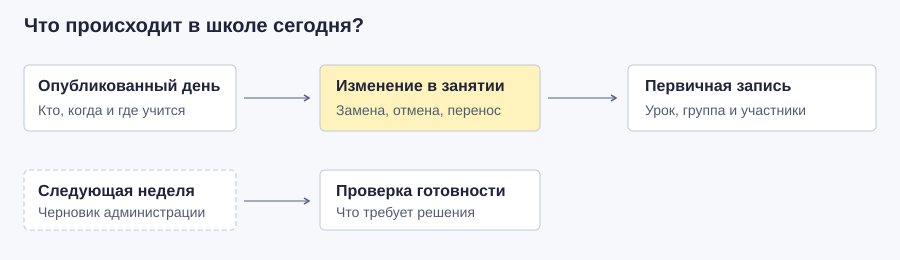

# Рабочее место завуча
Сохраняем знакомые пространственные ориентиры. Колонка слева отвечает на вопрос «где я», название и выборка в рабочей области — «с чем я работаю». Справа панель нужна только тогда, когда сверка двух объектов действительно помогает. Доска класса, дневное расписание и матрица оценок используют разные способы чтения.

## Токены

| Роль | Решение | Где видно |
|---|---|---|
| Текст и выбранный раздел | Чернильный `#202339`, белый текст на выбранном пункте | Навигация, крупные итоги и имена |
| Основное действие | Синий `#285ce0` | Ссылка ведёт к объекту; кнопка подтверждает операцию. Контур фокуса заметен и на белой поверхности |
| Текущий выбор | Жёлтый `#ffda38` и светлая подложка | Пиктограмма активного раздела, выделение текущего контекста. Значение всегда продублировано подписью или состоянием элемента |
| Фон, поверхность и граница | `#f6f8fc`, белый, `#dce2ec` | Рабочее поле и тонкие границы группировки. Таблица использует единый фон |
| Текст второго уровня | `#555f73` | Дата, роль человека, пояснение к выборке |
| Коралловый и семантические оттенки | Коралловая точка марки, тёплый тон требует внимания, холодный отмечает выбор, зелёный допустим для подтверждённого состояния | У статуса всегда есть словесная подпись. Цвета предметов и преподавателей принадлежат конструктору |
| Типографика | Локальный Onest и системный запасной шрифт | Крупный заголовок один на экран; имя, число или время — первая точка чтения строки. Для числового сравнения выравнивать однотипные величины |
| Размеры и адаптация | Светлая боковая колонка 220 px на настольном экране. При недостатке места меняется раскладка деталей; широкая сетка имеет собственную прокрутку | Клавиатурный доступ к таблицам и управлению. Для мобильного экрана сохраняется меню разделов |

## Разделы и первичная рекомендация

| Раздел | Решение для обсуждения | Компромисс / испытание |
|---|---|---|
| Каталог журналов | С для обзора предметов выбранного класса | Сколько действий нужно, чтобы открыть знакомый журнал и обнаружить ошибку источника? |
| Открытый журнал | С при сравнении всей группы, Д при разборе отдельной работы | Проверьте соседние категории, пересдачу, отсутствие результата и итог на ноутбуке |
| Ученики и группы | Доска С для комплектования; альтернативный маршрут Д для поиска одного человека | Найти подгруппу, проверить её состав, вернуться в тот же контекст |
| Список преподавателей | Обзор С для просмотра состава. Д — когда вопрос начинается с предмета или группы | Проверьте длинное имя и отсутствие назначений |
| Профиль | Вынести школьную деятельность выше контактов | Сверить два назначения и день преподавателя, открыть связанный объект |
| Форма | Единственная основная команда сохранения, локальная отмена, подписи вне полей | Ошибка не должна стирать введённое. Доступность операции определяется правами действующего продукта |
| Настройки | Приоритет — состояние связи и понятное исправление | Раскрыть детали, пройти восстановление соединения; в прототипе внешняя операция моделируется |
| Предпросмотр | Сначала роль и человек, затем день и результат | Проверять границы периода и смену пользователя. Campus показан исходными иллюстрациями |
| Сегодня | Хронология опубликованного дня с переходом от исключения к занятию | Не смешивать ещё не выпущенные позиции следующей недели с доступным ученикам расписанием |
| Аналитика | Нагрузка преподавателей и классов имеет свои единицы и покрытие. Первичная запись доступна из детализации | Сумма уроков, длительность дня и число выставленных результатов отвечают на разные вопросы |
| Виджеты | Собственная раскладка, отдельный фильтр каждого экземпляра | Проверить два виджета одного типа, возврат к сохранённым настройкам и пустую выборку |

## Сокращение шума
Повседневное действие принадлежит объекту: выбор периода — журналу, состав — группе, проверка подключения — источнику. Дополнительные действия получают подписи в меню конкретной записи. Технический идентификатор раскрывается вместе со сведениями об источнике. Ошибка и способ её устранить остаются в рабочем контексте. Предложений об удалении функций нет. Полное соответствие существующим операциям описывают карты [журналов](journal-map.md), [справочников](directory-map.md) и [оперативных экранов](operations-map.md).

## После выбора
Согласовать макет и сценарии одного раздела с завучем. Затем отдельными PR вводить токены и общие элементы, журналы, доску и состав, преподавателей и профили, формы и административные инструменты. Для каждого PR сверять операции по карте, клавиатурные маршруты и визуальную регрессию. Подключать новые функциональные разделы по мере проверки их серверных контрактов. Архитектурные изменения ведутся отдельно.

