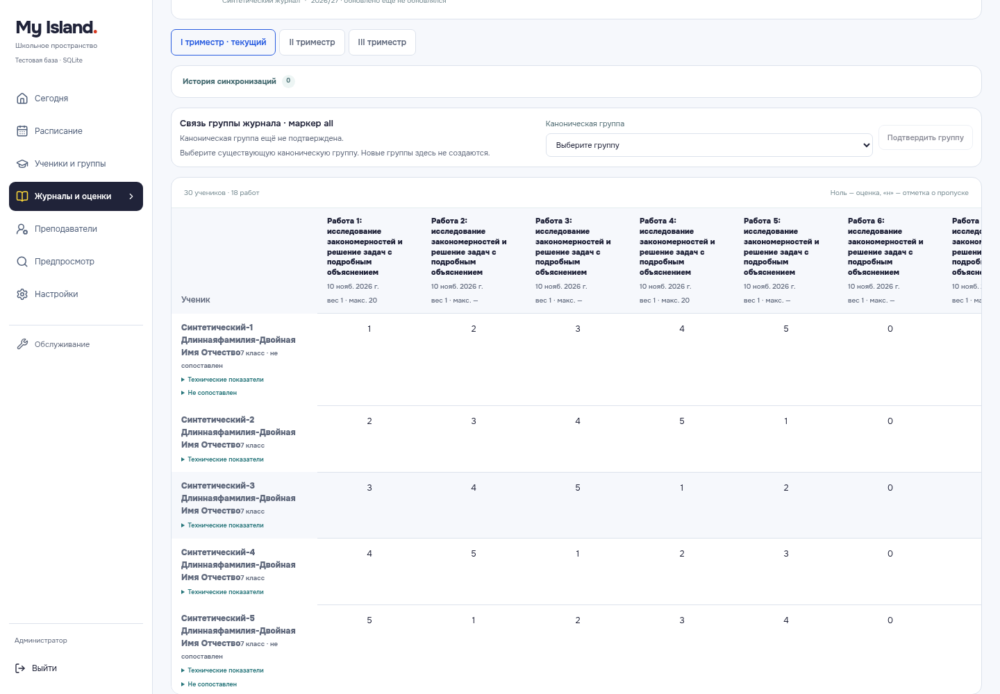
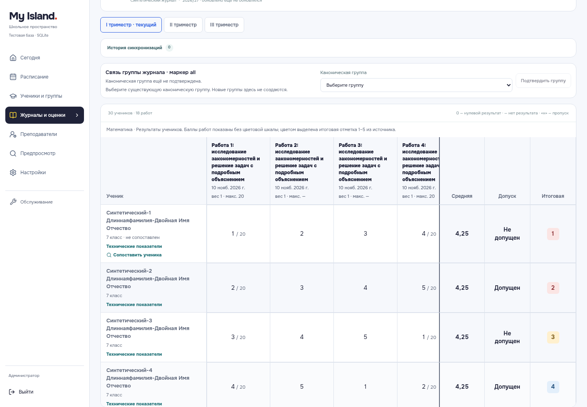
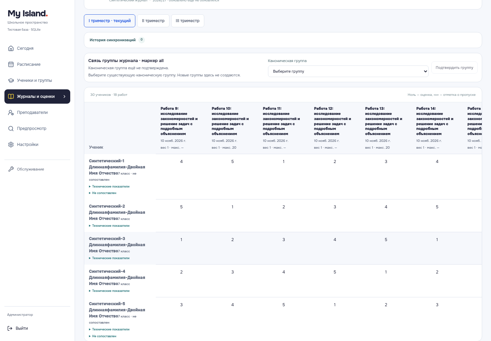
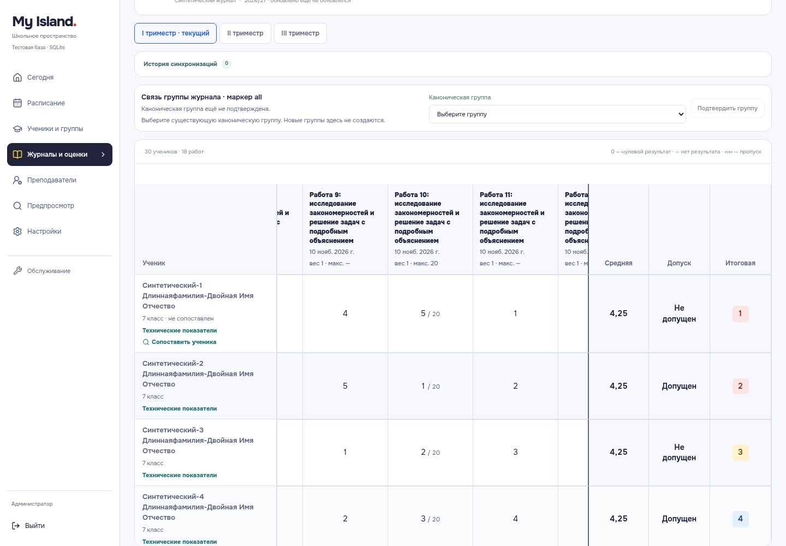
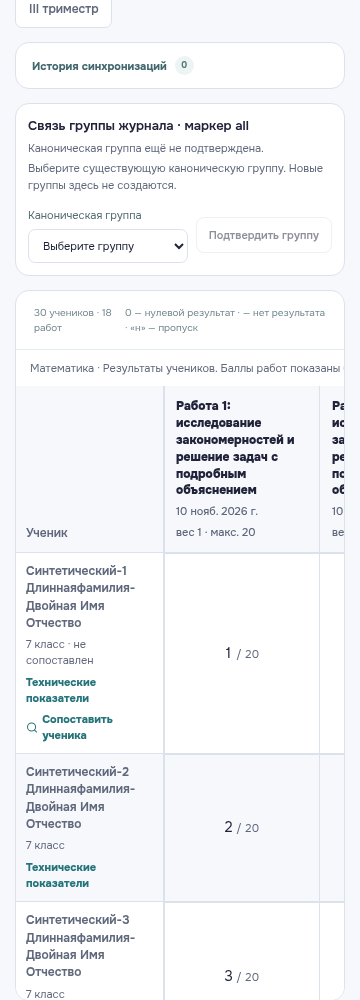
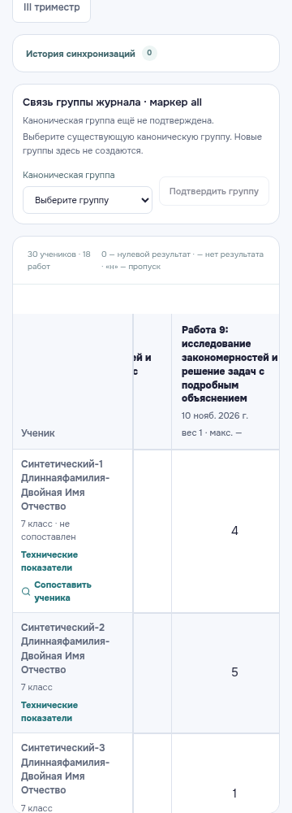

# Admin journal readability

Synthetic browser evidence: 30 pupils, 18 assessments, long names/titles, points, zero, absent result and special statuses. No production pupil records are included.

## Before and after

| Before | After |
| --- | --- |
|  |  |
|  |  |

The pupil column wraps names separately from group/matching information. Assessment headings retain date, weight and maximum. Rows/columns have visible boundaries. Summary columns have their own background and separator; they stick right only when the scroll surface is at least 1000px wide. Smaller surfaces retain one horizontal scroll area and the left pupil column. Technical values open below the table, with keyboard focus and return to the triggering button, without changing row height. Matching remains available.

## Grading semantics

`journal_detail` exposes assessment `max_score`, numeric results and statuses, but no explicit grading scale. Neither an absent maximum nor a maximum of 5 proves an ordinary mark. Assessment points therefore stay neutral, including 4/20; a provided maximum is displayed alongside the result. Only explicit `term_grade` summaries containing integer 1–5 receive green/blue/amber/red mark styling. Average/admission values are read from source summaries; no average is computed. Zero, missing results, attendance and boolean statuses remain distinct. This intentionally limits colour coverage until the API provides reliable assessment scale metadata.

No backend, database schema, importer, journal matching algorithm, term selection logic, authorisation, schedule or production data changed. No sync, merge or deployment was performed.

## Validation

- TypeScript (`npx tsc --noEmit`): passed.
- Frontend build with explicit local API URL and local-test mode: passed.
- Targeted lint for changed TypeScript: passed.
- Repository lint: fails on 10 pre-existing errors in unchanged schedule files and `e2e/day-modes-local.spec.ts`.
- Backend local environment: 590 tests, OK, 9 skipped (optional PostgreSQL configuration absent), run once during environment preparation.
- Journal role tests: 5 passed. Local auth tests: 6 passed.
- Targeted Playwright: viewport widths 1920, 1440, 1280, 768, 430, 390, 360; synthetic data; scroll/sticky geometry, long names, source summaries, marks 1–5, point values, zero/missing/status distinction, technical panel and selectors.

All seven viewport cases passed against unchanged application files. The selector case initially used a button locator for the existing trimester tabs; after correcting the test to query the tab role, the navigation case passed separately (8 targeted cases passed in total). An earlier visual pass overlapped HMR and was superseded.

For the normal isolated E2E runner, use `npm run test:e2e -- e2e/admin-journal-readability.spec.ts`. This environment was checked using its system Chromium and the already-running manual local-test server, with the following ignored config at `.local-test/journal-playwright.config.ts`:

```ts
import { defineConfig } from '@playwright/test';
export default defineConfig({
  testDir: '../e2e', testMatch: 'admin-journal-readability.spec.ts',
  workers: 1, reporter: 'line', outputDir: './journal-results',
  use: {
    baseURL: 'http://127.0.0.1:3011',
    launchOptions: { executablePath: '/usr/bin/chromium' },
    screenshot: 'only-on-failure',
  },
});
```

Start with `source .venv/bin/activate` and `MY_ISLAND_TEST_PROFILE=manual npm run dev:local`, then run `npx playwright test --config .local-test/journal-playwright.config.ts`. Tests intercept journal API reads; no external journal is accessed. Playwright browser downloads are forbidden by the current network policy, so the installed system Chromium was used.

## Mobile viewing




