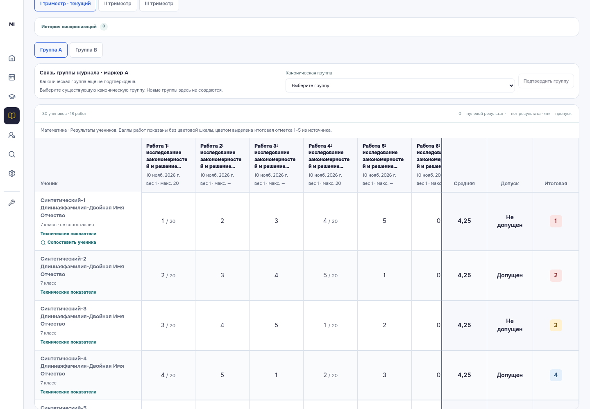
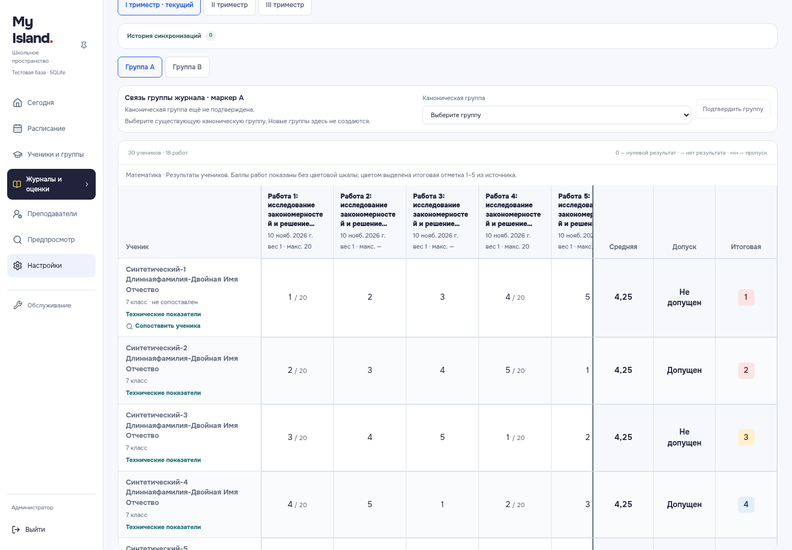
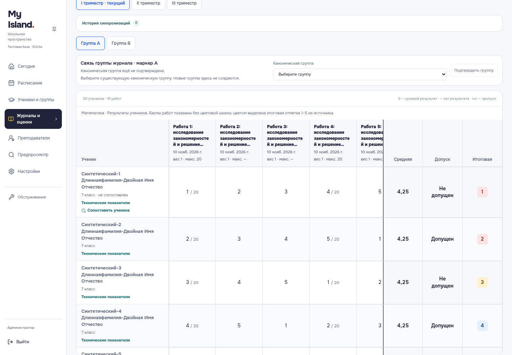
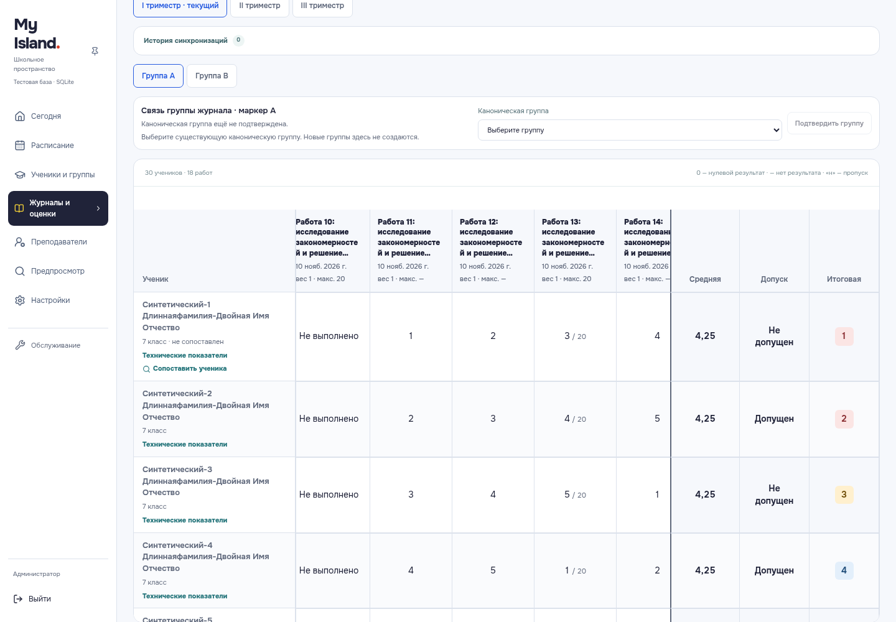
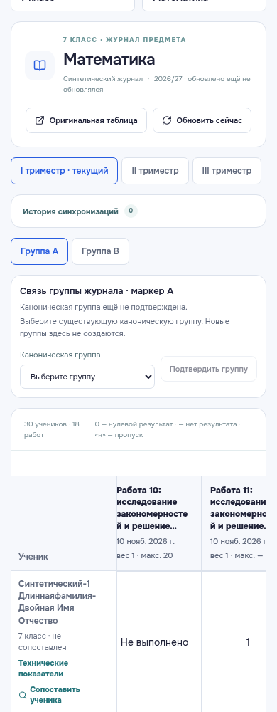

# Compact journal follow-up

Assessment columns are uniformly 132px. Titles use at most four lines and keep their full text in a native tooltip; date, weight and maximum are outside the clamp. Grade font size is unchanged.

The existing Sidebar now enables its compact mode for journals as well as the constructor. Desktop grid tracks follow the actual sidebar state (58px collapsed, 188px expanded/pinned), reserving space rather than overlaying the table. Mobile retains the horizontal navigation and All sections dialog. Maintenance retains its icon, tooltip and accessible label.

At 1440px with the synthetic fixture, **5 complete work columns** fit with collapsed navigation and **4** with expanded/pinned navigation, plus a partially visible next column. Pupil and three summary columns remain visible. The count excludes partially covered columns.

| State | Screenshot |
| --- | --- |
| Compact, 1440px |  |
| Hover expanded |  |
| Pinned |  |
| Pinned, horizontal scroll |  |
| Mobile, 390px |  |

Only synthetic records: 30 pupils and 18 works. No production access, backend/schema/import/grade/term/auth changes, merge or deployment.

Validation: TypeScript, frontend build with explicit local API, targeted lint, the existing eight E2E cases plus the menu/table case, and five journal-role unit tests passed. Checks cover 1920/1440/1280/768/430/390/360px, hover/pin/unpin, grid allocation, summary/name separation and title clamp/tooltip. A separate route regression checks normal navigation on People and hover expansion on the constructor. No full backend suite was repeated.
