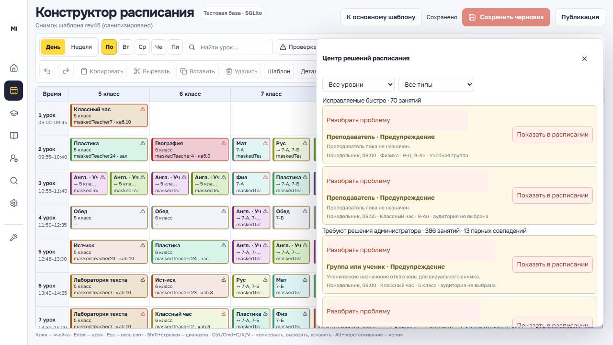
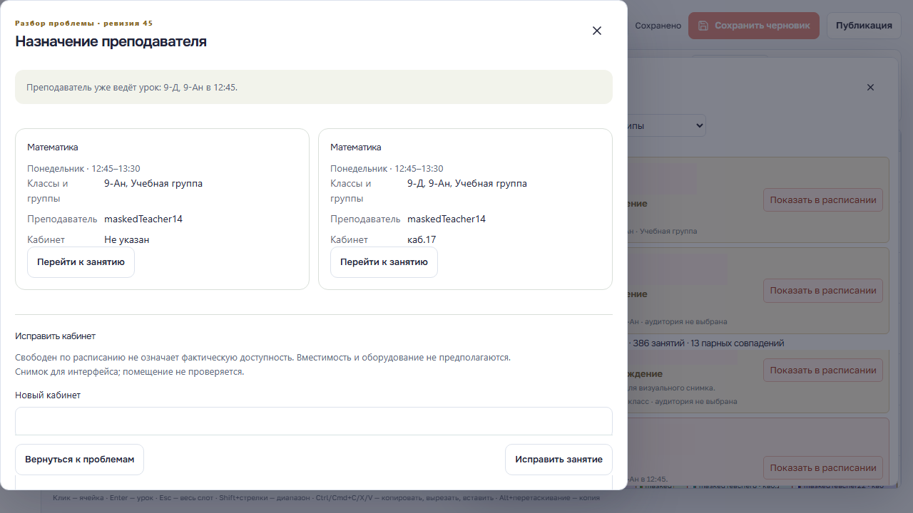
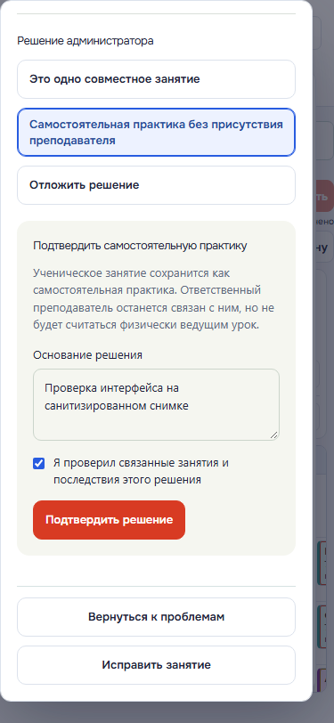

# Локальный аудит публикации источника, 29 октября 2026

Проверен сохранённый шаблон ревизии 45 (386 исходных записей), неделя 26 октября — 1 ноября. Источник baseline указывает commit `1305cc7`; аудит выполнен по текущей рабочей реализации (HEAD на старте — `f236b6e`). Preview шаблона и недели выполнялся в режиме read-only. Для проверки сохранения неизменяемого источника publication отдельно создана только в локальной копии SQLite; исходный snapshot и JSON остались побайтно неизменными.

## Результат

- Published source содержит все 386 записей: 249 в разрешённой проекции и 137 unresolved. Это совпадает с предыдущим baseline 249/137. Из 249 разрешённых записей у 131 нет замечаний, 118 разрешены с замечаниями. Критических блокеров preview не нашёл.
- 31 запись с неизвестной аудиторией остаётся unresolved и не получает список учеников. Ещё 106 unresolved записей относятся к другим проблемам; 137 — общее число unresolved.
- Для 26 строк шестого класса старый подтверждённый состав — 16, текущий preview правила класса — 17; добавление одного активного ученика локально проверено как предложение массового обновления. Это preview, а не подтверждение решения администратора.
- Пересечения 34 ученических пар сохранены как диагностические данные. Текущий preview содержит 6 `joint_activity_unconfirmed` диагностик: похожее название предмета и совпадающий преподаватель не считаются достаточным основанием для подтверждения исключения.
- Для этих 6 возможных совместных случаев кабинет в аудитном ходе не назначался и совместность не подтверждалась: нужны проверка аудитории и явное решение администратора.
- Проверка точных интервалов нашла 78 исходных записей, делящих кабинет с другой строкой расписания. В этот счётчик входят и совместные занятия; это не 78 доказанных ошибок. Для каждой записи нашлись свободные по расписанию альтернативы среди 21 кабинета черновика. Фактическая доступность, вместимость и оснащение не подтверждаются этим поиском.
- Локальная публикация недели записала источник отдельно от projection. Readback при создании совпал с preview, запись содержала 386 записей, а runtime readback подтвердил 249 назначений. В изолированной копии прямое повреждение архива было отклонено при чтении `get_published_source`: checked source сверяет архив с preview, payload fingerprint, количеством и набором исходных записей. Это проверка уровня приложения; аудит не утверждает, что SQLite запрещает прямые изменения строки.
- Фактическую опубликованную неделю сверили со всеми 115 активными учениками и 24 преподавателями: совпали 2 541 ученическая и 185 преподавательских ACTIVITY signatures с ранее проверенным безопасным кандидатом. Проверены 601 ученический и 109 преподавательских UNRESOLVED markers: каждый ссылается на исходные записи с подтверждённым владельцем и точным интервалом. Из 31 строки с неизвестной аудиторией ни одна не вошла в безопасные назначения. Подробные агрегаты — в `runtime-verification.json`.

## Ограничения

Это локальный аудит сохранённого snapshot, а не проверка актуальности школы или подтверждение реальных исключений. В отчёте нет имён, ученических/учительских идентификаторов или исходных payload. Исторические проекции student/teacher сравниваются с `legacy_canonical.py` на каждой сохранённой неделе; результаты и количество проверенных идентичностей записаны без их идентификаторов в `summary.json`. Никакие production, внешние сервисы и исходные школьные данные не изменялись.

## Интерфейс

Ниже — реальные снимки локально отрисованного интерфейса с 386 исходными строками rev45. Преподаватели заменены псевдонимами; ученические назначения отключены в визуальном fixture. Поэтому счётчики проблем на изображениях не являются диагностической статистикой настоящей школы: её подтверждают отдельные `summary.json` и `runtime-verification.json`. В визуальном сценарии ничего не подтверждалось и не публиковалось.

## Проверка сборки

TypeScript, lint, 60 JavaScript-тестов и сборка Sites/Vinext прошли. Сборка выполнялась в отдельной локальной копии без `.env` и с явным `VITE_API_BASE_URL=https://my-island-api.onrender.com`. Артефакт не загружался и не публиковался. Браузерные проверки выполняются на изолированных loopback-портах 3011/8011 и синтетической SQLite.

Playwright: **23 из 23 сценариев прошли**, включая исправление кабинета и undo, совместный урок и отмену, сохранение настоящего конфликта с третьим занятием, самостоятельную практику, полный список массового пересчёта, устаревший preview, технический блокер, desktop/mobile/landscape, Student/Teacher Campus и визуальный снимок rev45. Исправлено завершение тестового запуска на Windows: runner владеет только своими тестовыми серверами и закрывает их дерево процессов. После проверки порты 3011/8011 освобождены.

Основная команда: `node scripts/run-e2e.mjs e2e/constructor-resolution.spec.ts e2e/constructor-publication.spec.ts e2e/student-journals.spec.ts e2e/rev45-ui-screenshot.spec.ts`. Для визуального сценария rev45 нужна переменная `MY_ISLAND_REV45_FIXTURE` с абсолютным путём к локальному обезличенному JSON; без неё этот сценарий явно пропускается. Приватные данные школы тестам для исправлений и подтверждений не нужны.

## Коммиты и готовность

- `f236b6e` — сохранение полного неизменяемого источника публикации.
- `682204e` — серверные подтверждения, исправления, безопасные проекции и проверки целостности.
- Интерфейс, совместимость Campus, визуальные проверки и этот отчёт оформлены отдельным третьим коммитом.

Локальная реализация готова к ревью. Для production нужны отдельное разрешение и проверки конкретных выпускаемых frontend/backend-версий. Этот этап не выполнял production-релиз и не подтверждал Telegram на физических устройствах. 137 нерешённых записей сохраняются в полном источнике и сами по себе не запрещают публикацию с замечаниями; достоверность их назначений остаётся предметом решения администратора. Критические технические ошибки по-прежнему блокируют операцию.

## Повторение

Для повторения на этой машине нужен сохранённый приватный snapshot и локальный скрипт: `python .local-test/resolution-audit/run_audit.py`. Они намеренно не включены в Git. Скрипт создаёт рабочие копии в `.local-test/resolution-audit/`; он не запускает миграции или внешние действия. Независимые синтетические проверки находятся в отслеживаемых backend- и E2E-тестах.

Подробное описание модели, механизмов подтверждения и результатов backend/PostgreSQL-проверок: [IMPLEMENTATION.md](IMPLEMENTATION.md).
