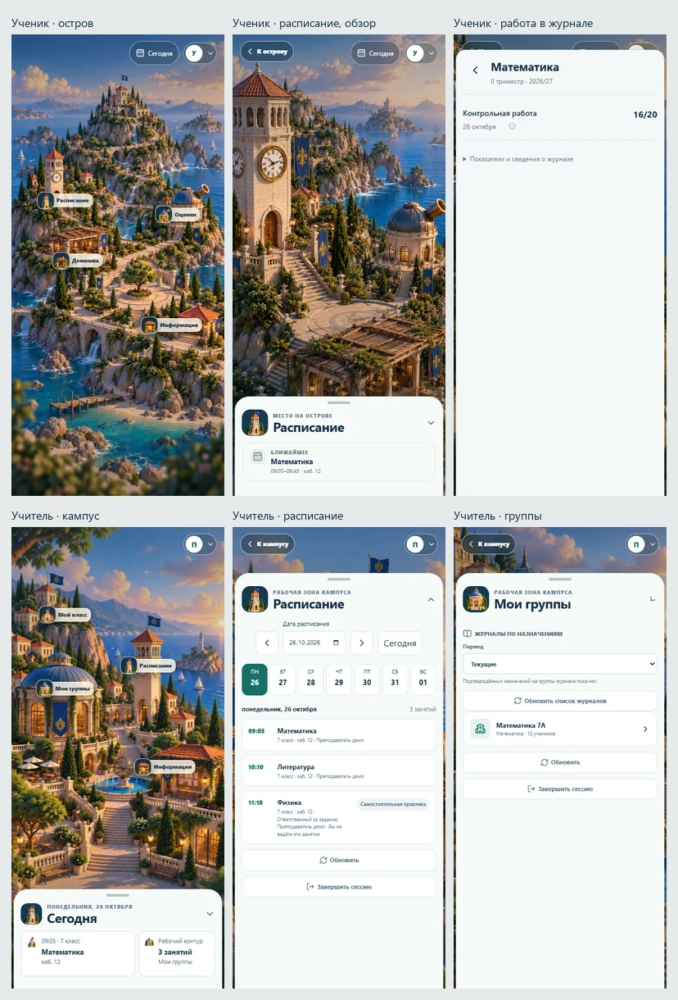

# Аудит текущего кампуса My Island

Проверены текущие компоненты, стили и изображения кампуса из ревизии `b38f27c`. Playwright и Chromium эмулировали сенсорные экраны 390 × 844 и 320 × 640 CSS px. Локальная клиентская сборка подключала реальный `app/page.tsx` с его CSS. Запросы перехватывались браузером. Авторизация, Telegram BackButton и школьные данные были синтетическими. Кадры на листе сняты при 390 × 844.

Это исторический аудит интерфейса на `b38f27cb12bf3fa939a51a5d220c8a2bc2e10598`, а не повторная проверка `origin/main` (`5843f685fc18ed8ddcc158c299d4aca097831bbf`). Ссылки на исходники закреплены за проверенной ревизией.

## Сценарии

- Ученик. Проверены остров, «Сегодня», расписание, домашние задания, оценки, детали журнала, информация и профиль. Проверены состояния обзора и развёрнутой панели. Browser Back вернул детали журнала к списку, Telegram Back свернул открытые разделы до обзора.
- Учитель. Проверены кампус с панелью «Сегодня», расписание, предметные группы, классное руководство, информация и профиль. Telegram Back из развёрнутого раздела переводит прямо в кампус. Следующий Browser Back **снова открывает расписание**, поскольку выход добавляет запись истории.
- Состояния данных. Проверены утверждённый доступ, ожидание подтверждения, опубликованное расписание с пустым днём и неопубликованное расписание. В последнем случае ученик видит одновременно «Нет занятий» и «Неделя не опубликована». Учитель видит предупреждение о недоступности источника.
- Мобильное управление. Основные маршруты выполнялись синтетическими касаниями, горизонтального скролла документа на проверенных экранах не было. Интерактивные зоны меток в исходном состоянии имеют высоту 44 px. Физический Telegram WebView, жесты iOS и реальное устройство остались вне проверки.

## Журналы, Classroom и ошибки загрузки

- **Журналы учителя.** В «Моих группах» селектор «Источник и группа» открывает данные назначенного журнала внутри панели. Проверены текущий период и обращение к архивному источнику после смены периода. По работе показаны дата, вес, максимум, число оценок, строки учеников с числом или статусом и сводный балл. Отдельных переходов в работу или в профиль результата ученика в этой панели нет. В карточке группы отдельно проверены вкладки «Журнал» со списком работ и «Ученики» со сводкой истории. [Назначенные журналы](https://github.com/Surpd/my-island/blob/b38f27cb12bf3fa939a51a5d220c8a2bc2e10598/components/role-journals.tsx#L322), [Карточка группы](https://github.com/Surpd/my-island/blob/b38f27cb12bf3fa939a51a5d220c8a2bc2e10598/app/page.tsx#L1474)
- **Classroom учителя.** Связанный курс виден в обзоре группы. В данных курса была синтетическая ссылка, однако строка с иконкой внешней ссылки отрисована обычным `div` без `href` и доступа по Tab. Переход в курс из этой строки недоступен. [Курсы группы](https://github.com/Surpd/my-island/blob/b38f27cb12bf3fa939a51a5d220c8a2bc2e10598/app/page.tsx#L1677)
- **Сдача домашней работы.** У ученика есть ссылка «Открыть» на исходное задание. При переданных статусе `TURNED_IN`, назначенной оценке и отдельной ссылке на сдачу карточка их не показала. API возвращает поле `submissions`, а клиент берёт из ответа только `items`. Отдельная кнопка сдачи и переход к результату в панели отсутствуют. [Карточка задания](https://github.com/Surpd/my-island/blob/b38f27cb12bf3fa939a51a5d220c8a2bc2e10598/app/page.tsx#L697), [Ответ API](https://github.com/Surpd/my-island/blob/b38f27cb12bf3fa939a51a5d220c8a2bc2e10598/backend/handlers/api.py#L780)
- **Переключение роли.** На синтетической сессии с двумя разрешёнными ролями проверен цикл «ученик → учитель → ученик». После смены запрашивается сессия выбранной роли, открывается её главный экран и очищается параметр `screen`. [Смена роли](https://github.com/Surpd/my-island/blob/b38f27cb12bf3fa939a51a5d220c8a2bc2e10598/app/page.tsx#L3763)
- **Сетевой сбой и HTTP 503.** При обрыве запроса расписания появляется «Сервер недоступен», при HTTP 503 — «Не удалось загрузить данные» с сообщением API. После восстановления запроса кнопка «Повторить» вернула кампус в обоих случаях. HTTP 503 при открытии *карточки группы* ведёт к другому дефекту **P1**. Ошибка подменяется пустыми данными, вкладка «Журнал» показывает «Журнал не сопоставлен» без сообщения о сбое и повторной загрузки. [Общий экран ошибок](https://github.com/Surpd/my-island/blob/b38f27cb12bf3fa939a51a5d220c8a2bc2e10598/app/page.tsx#L3610), [Загрузка группы](https://github.com/Surpd/my-island/blob/b38f27cb12bf3fa939a51a5d220c8a2bc2e10598/app/page.tsx#L1486)

## Приоритеты редизайна

| Приоритет | Наблюдение | Следствие |
| --- | --- | --- |
| P1 | После открытия расписания и нажатия Tab фокус уходит на скрытую кнопку с `opacity: 0`. У ученика это «Домашка», у учителя — «Мои группы». | Клавиатурная навигация теряет видимый фокус. При открытом разделе скрытые метки нужно исключать из порядка Tab и переносить фокус на активный слой. [SceneFrame](https://github.com/Surpd/my-island/blob/b38f27cb12bf3fa939a51a5d220c8a2bc2e10598/app/page.tsx#L1180), [CSS меток](https://github.com/Surpd/my-island/blob/b38f27cb12bf3fa939a51a5d220c8a2bc2e10598/app/globals.css#L2941) |
| P1 | Выход из развёрнутого раздела расходится между ролями. У учителя Telegram Back пропускает обзор, а Browser Back может восстановить только что закрытый раздел. | Одинаковые уровни интерфейса требуют общей модели истории и одного шага назад. [Навигация ученика](https://github.com/Surpd/my-island/blob/b38f27cb12bf3fa939a51a5d220c8a2bc2e10598/app/page.tsx#L1267), [Навигация учителя](https://github.com/Surpd/my-island/blob/b38f27cb12bf3fa939a51a5d220c8a2bc2e10598/components/campus-controls.tsx#L23) |
| P1 | На неопубликованной неделе ученик одновременно получает вывод «Нет занятий» и предупреждение об отсутствии расписания. | Отсутствие данных выглядит как подтверждённый пустой день. Заголовок дня должен отражать состояние источника. [Расписание ученика](https://github.com/Surpd/my-island/blob/b38f27cb12bf3fa939a51a5d220c8a2bc2e10598/app/page.tsx#L630) |
| P2 | На карте ученика четыре ярлыка с небольшим текстом и без сводных данных. Чтобы прочесть все занятия, нужно открыть метку и развернуть панель. Учитель уже видит ближайшее занятие внизу кампуса. | Для ежедневного использования стоит сохранить роль карты в ориентации, дать видимый короткий путь к ближайшему действию и сохранить проверенную структуру расписания внутри панели. |
| P2 | При старте обеих ролей запрашивается загрузочный PNG 2,69 МиБ, затем мастер роли около 0,26–0,29 МиБ. Первое открытие расписания требует декодирования отдельного WebP 0,32–0,45 МиБ перед началом камеры. | Загрузочное оформление отнимает часть бюджета первого экрана. [Фон загрузки](https://github.com/Surpd/my-island/blob/b38f27cb12bf3fa939a51a5d220c8a2bc2e10598/app/globals.css#L1652), [Камера](https://github.com/Surpd/my-island/blob/b38f27cb12bf3fa939a51a5d220c8a2bc2e10598/app/scene-motion.ts#L35) |

## Камера и движение

Расписание открывается тремя параллельными анимациями по 700 мс. Мастер и крупный план меняют масштаб и непрозрачность. Третий слой временно размывает всю сцену до 22 px. При `prefers-reduced-motion: reduce` измерена одна 100 мс анимация непрозрачности без зума. В двух локальных измерениях `requestAnimationFrame` с эмуляцией CPU ×4 и окном 1,5 с вокруг открытия расписания у ученика 2 из 84 интервалов превышали 33,4 мс, у учителя 3 из 78. Эти числа описывают лабораторный прогон Chromium. Скорость декодирования на телефоне и стабильность частоты кадров в Telegram требуют замера на устройстве.

## Проверка исходников

Impeccable Detect проверил исходники кампуса и общие стили. Все четыре отчёта о боковой акцентной полосе относятся к классам конструктора расписания и студии, за пределами проверенных экранов. Приоритеты выше подтверждены в браузере. Полный замер цветового контраста не проводился.

## Что сохранить

Иллюстрации хорошо различают ученический остров и более собранный кампус учителя. Расписание в развёрнутом виде имеет понятную последовательность «неделя → день → время → предмет». В оценках ученика переход от списка предметов к конкретной работе сохраняет контекст через Browser Back. Эти детали можно перенести в новый интерфейс вместе с разделением опубликованного, пустого и недоступного расписания.
