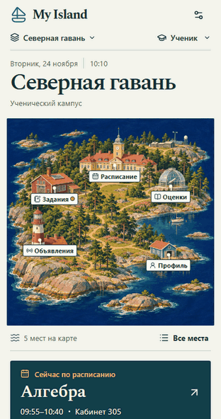

# My Island · Student и Teacher Campus

Владелец выбрал **«Северную гавань»** — дневной остров с синей водой и зелёными деревьями. Обе роли начинают здесь. День и ночь для одного и того же острова — предложение для следующего этапа.

[Скачать интерактивное демо одним ZIP-файлом](https://github.com/Surpd/my-island/raw/refs/heads/codex/campus-design-review/prototypes/campus/review/My-Island-Campus.zip). Распакуйте архив и откройте `My-Island-Campus.html` в браузере. Внутри шесть кампусов. Ниже — запись ученического маршрута в окне шириной 390 px. Её можно посмотреть прямо на GitHub. [Открыть неподвижный кадр](./review/harbour-mobile.png).



Демо фиксирует школьный день 24 ноября 2026 года, 10:10. Смена концепции и роли находится в шапке. Нажмите здание, его подпись или «Все места». Кнопка со стрелкой возвращает на предыдущий уровень, крестик выводит на остров. В настройках доступны загрузка, ошибка, пустой ответ, неопубликованная неделя и назначение классного руководителя.

## Как открыть

Для ревью исходников используйте Node.js версии, указанной в корневом `package.json`. Установите зависимости через `npm ci` из корня проекта и запустите:

```powershell
node node_modules/vite/bin/vite.js --config prototypes/campus/vite.config.mjs
```

Открыть [локальное демо](http://127.0.0.1:4176). Для передачи без сервера команда ниже записывает автономную страницу по выбранному пути. Иллюстрации, интерфейс и шрифты включены в HTML. Ссылка Classroom при явном нажатии открывает внешний сервис.

```powershell
node prototypes/campus/export.mjs "$env:TEMP/My-Island-Campus.html"
```

## Выбор направления

[Сравнение всех трёх направлений](./review/campus-directions.webp) показывает для каждого стиля ученический и преподавательский острова до и после входа в расписание.

| Направление | Остров и ориентиры | Как выглядит открытая локация |
| --- | --- | --- |
| **Северная гавань** | Светлый приморский кампус. Красная крыша мастерской, купол и полосатый маяк читаются по силуэту. У преподавателя мастерские и оранжерея стоят вокруг отдельной бухты. | Крупный план 2,12× за 580 мс. Светлая панель, заголовки Spectral и цвет морской воды в управляющих элементах. |
| **Бумажный атлас** | Двухкрасочная печать с кобальтовыми горизонталями и архитектурой в разрезе. На широком экране карта расположена слева, как раскрытая страница атласа. | Более короткое приближение 1,9× за 460 мс. Узкий Oswald, прямоугольные указатели и фоновый цвет бумаги связывают расписание с картой. |
| **Ночная станция** | Вулканическая диорама. Подсвеченные окна, купола и лестницы ведут взгляд между зданиями. Учительский остров образует замкнутую гавань. | Увеличение 2,22× за 660 мс. Светлые буквы и янтарное время занятий на тёмной панели сохраняют ночное освещение. |

**Почему для следующего этапа выбрана «Северная гавань».** На телефоне у её зданий различаются и форма, и цвет. Башня расписания остаётся узнаваемой при открытии списка. «Атлас» подойдёт для более графичной айдентики, но мелкая штриховка на 360 px конкурирует с подписями. У «Ночной станции» огни хорошо ведут к зданиям, тогда как тёмные дорожки требуют проверки при дневном свете на физическом телефоне. Это вывод проектной приёмки; исследование со школьниками и преподавателями предстоит.

## Что изменилось в сценариях

- Ученик видит ближайшее действие и свежий результат рядом с картой. Домашние задания соединяются с записями сдачи. В журнале хранятся исходные баллы, максимум, вес, статус и итоги триместра.
- Учитель входит в группу один раз и переключается между журналом, составом и аналитикой. Из работы доступны индивидуальные результаты. Окна и текущие занятия подписаны по расписанию. Для регистрации проведённого урока потребовался бы отдельный источник.
- Назначение классного руководителя управляет доступностью локации. Объявления имеют ролевую аудиторию. В демо переключатель ролей меняет вымышленную личность; в приложении доступ определяется авторизованной сессией.
- Реальные источники, пробелы контрактов и порядок внедрения перечислены в [матрице данных](./DATA.md). Аудит текущего приложения с кадрами, воспроизведёнными ошибками и условиями измерений — в [AUDIT.md](./AUDIT.md).

## Инструменты и решения

| Инструмент | Что проверено или запущено | Решение и результат |
| --- | --- | --- |
| Frontend Design | Локальный SKILL.md и официальный текст Anthropic. Композиция, средства печати, типографика и визуальная иерархия проверены по трём отдельным направлениям. | Шесть иллюстраций с собственными силуэтами и раскладкой зданий, два локальных кириллических шрифта. |
| Impeccable | context, concept-seed, материалы init, critique, craft-floor и polish, Detect для исходного Campus и мобильного демо. Повторный просмотр скриншотов. | Исправлены видимость здания над панелью и расположение крайней подписи. Невидимые метки исключаются из клавиатурного обхода; после возврата фокус восстанавливается. |
| ImageGen | Встроенный генератор, отдельный запрос для карты каждой роли в каждом стиле. Кадры проверены, подготовлены шесть WebP 1254 × 1254. | Камера увеличивает исходную иллюстрацию вокруг здания. Дополнительная картинка крупного плана не загружается. [Иллюстрации](./art/) |
| Modern Web Guidance | Установленный официальный CLI 1.0.2, восемь поисков и retrieve. Изучены motion, same-document-transitions, scoped-component-transitions, physics-based-easing, dialog, responsive-design, accessibility и optimize-image-priority. | Нативный dialog, dvh, приоритет активного изображения, обратимый transform и вариант reduced motion. Камера работает без таймера, привязывающего открытие панели к заданной длительности. |
| Реестр компонентов, Motion for React | Через Google Sheets прочитаны 11 позиций вкладки «UI-библиотеки». Сопоставлены shadcn/ui, TelegramUI и открытый ReUI Data Grid. Прочитана документация Motion. | Для панели достаточно нативного dialog. Для кнопок карты использован установленный Lucide React. ReUI Data Grid — кандидат для будущего полноразмерного журнала. Добавочных runtime-пакетов и платных компонентов в демо нет. |
| Browser / Playwright | Локальная сборка существующего Campus и отдельное демо в Chromium. Оба кампуса пройдены на синтетических школьных данных. | Проверены маршруты, скриншоты, прокрутка, клавиатура, обратная навигация, прерванный зум и состояния источника. |
| Stitch MCP | В инвентаре сессии отсутствовали вызываемые методы Stitch. | Для арта использован ImageGen, для композиционного сравнения — три работающих варианта в браузере. |

[Frontend Design](https://github.com/anthropics/skills/tree/main/skills/frontend-design) · [Impeccable](https://github.com/pbakaus/impeccable) · [Modern Web Guidance](https://github.com/GoogleChrome/modern-web-guidance) · [Motion for React](https://motion.dev/docs/react)

## Камера и совместимость

Для одного постоянно смонтированного изображения CSS интерполирует масштаб и смещение на одном слое. Контрольная точка привязана к координатам здания. Кривая linear() плавно гасит скорость, для более старых WebView задан cubic-bezier. При reduced motion панель доступна сразу. Пружинная анимация Motion for React была бы уместна для перетаскивания карты с инерцией. Такого жеста в этих прототипах нет.

Same-document View Transitions полезны для перехода между разными компоновками через снимки. Для этого движения снимок всего документа закрывал бы живую карту и собственные элементы управления. Scoped View Transitions можно рассмотреть при замене списка внутри панели. Поддержку потребуется проверять на Element.prototype, при её отсутствии список сможет обновиться сразу.

## Задание для независимого ревью

База ветки — `5843f68` (`main` на момент публикации). Изменения находятся в `prototypes/campus/`. Исторический аудит воспроизводил поведение локальной ревизии `b38f27c`. Матрица данных учитывает последующую сверку с базой ветки. Прототип работает на фикстурах и не запрашивает школьные API.

| Что проверить | Где начать | Ожидаемый результат |
| --- | --- | --- |
| Камера и история | [main.jsx](./main.jsx), [campus.css](./campus.css). Открыть башню, отменить движение, выбрать другое здание, пройти назад из детали урока. | Камера приходит к выбранному зданию. Возврат идёт по одному уровню; фокус снова доступен на карте. При reduced motion панель открывается без приближения. |
| Экран Telegram | Вручную проверить 360 × 510 и 390 × 620, затем свернуть и развернуть Mini App на iOS и Android. | Все здания доступны пальцем, текст виден над системными отступами, панель прокручивается, кнопка возврата доступна. Реальный Telegram BackButton, safe area и жесты — отдельная проверка на устройстве. |
| Оценки и задания | [Interior.jsx](./Interior.jsx) и [матрица данных](./DATA.md). Сравнить ноль, пустой результат, исходный статус, пересдачу, опоздавшую сдачу и истёкший срок. | Срок и статус сдачи различимы. Ноль сохраняется. Для триместра используются исходные итоги школы. |
| Инструменты учителя | Открыть группу, работу и результат ученика, вернуться в состав. В настройках снять назначение классного руководства. | Группа и журнал доступны из одной локации. Локация класса исчезает без назначения. Production-доступ должен отдельно проверять сервер. |
| Частичные данные | В настройках выбрать ошибку, пустой ответ или неопубликованную неделю. Открыть расписание, проверить повтор после ошибки. | Ученик различает пустой день, ошибку источника и неделю, которую школа ещё не опубликовала. |

В отчёте ревью укажите концепцию и роль, размеры окна или модель устройства, шаги воспроизведения, фактический и ожидаемый результат. Для замечаний к данным приложите ссылку на контракт. Сначала перечислите ошибки, из-за которых невозможно завершить школьный сценарий.

## Приёмка

```powershell
npx playwright install chromium
node prototypes/campus/check.mjs
```

Проверены 132 открытия зданий в трёх концепциях, двух ролях и четырёх размерах: 360, 390, 430 и 1366 CSS px. Отдельный маршрут проходит вложенные оценки и группы, неделю с прокруткой, смену состояния данных, ошибку с повтором, скрытие классного руководства, клавиатуру, Browser Back, отмену до открытия панели и Telegram BackButton через тестовый адаптер.

На 390 px в отдельном прогоне обычного движения масштаб монотонно достиг 2,12×, 1,90× и 2,22×. В эмуляции CPU ×4 у каждого направления в одном окне наблюдения 900 мс был один межкадровый интервал длиннее 33,4 мс. Значения относятся к локальному Chromium и зависят от нагрузки машины. Для выпуска нужны физические Telegram WebView iOS и Android, включая проверку мелкой штриховки и декодирования на слабом устройстве.

В standalone HTML проверены все шесть островов, вход/возврат и восстановление учительского класса после перезагрузки. В офлайн-контексте браузера зафиксировано ноль HTTP-запросов при этом обходе.

<details><summary>Запросы ImageGen для исходных иллюстраций</summary>

**tide · ученик**

Square gouache travel-poster illustration of a single beautiful remote northern school island, inspired by midcentury Finnish archipelago prints, clear cut gouache silhouettes, ultramarine dark water filling all four edges, seafoam banding of the surf, green pine forests, pale coral and chalk red roofs, ochre paths. Hero map, gently tilted bird's-eye isometric view. Satellite shorelets, ladders, tide marks, delicate boats, quiet water. Clearly legible golden cream clocktower school at upper center, red-roof workshop to the left, glass observatory to the right, red and ivory lighthouse at lower left, small blue boathouse lower right, field station in back right. Frame the whole island comfortably, with 8% ocean margin. Architectural and atmospheric, NOT UI, no text or labels, no map pins or letterforms, no compass graphics. Precise and richly painted like a collectible travel poster.

**press · ученик**

Square overhead illustrated school campus map on an island, artisanal two-ink risograph atlas on pale butter-yellow uncoated paper. Warm printed cobalt blue engraved land contours, deep cobalt water hatching and tomato-red block print buildings, print grain, tight expressive linework, vernacular cartography like an unusual field guide. The island bends diagonally like a crescent, surrounded by dotted sandbanks and rock pools. Five distinct landmarks spaced apart: belltower school top left, a sawtooth roof workshop center left, circular reading rotunda in center right, lighthouse on narrow neck bottom left, little wharf boathouse bottom right; small inland field office top right. Leave edge margin with the water printed as sparse hatching on yellow paper. True overhead map with buildings drawn in a cutaway axonometric projection. Entire frame is the art, no typography, letters, logo, words, numbers, labels, border, pins or UI.

**orbit · ученик**

Square landscape artwork, high angle orthographic photograph of an exquisitely physical handmade architectural diorama of a nocturnal volcanic island school. Inky midnight blue sea edge to edge, dark basalt terraces, black pines, softly glowing butter-yellow miniature windows. Porcelain cyan observatory domes upper right, tall lit astronomy school tower upper middle, stepped copper workshop lower left, standalone lighthouse at left rocky point, small glowing boathouse at right front, greenhouse back right. Volcanic circular caldera and winding stepped amber paths; no other settlements. Tiny instrument-like scale, very crisp silhouettes, luminous reflections, meticulously modelled architectural materials, rich tonal detail in shadows. The island occupies 85 percent width. No horizon, star field or sky, text, labels, diagram lines, letters, signboards, framing, no UI.

**Преподавательский вариант каждого запроса**

Companion TEACHERS' island. Replace student architecture with a distinct professional campus, a smaller outer harbor/lagoon looking in from the sea. Distinct silhouettes and paths: upper left prominent collegiate clocktower (schedule), upper right timber faculty greenhouse (homeroom), middle-left pair of tall faculty studios with sawtooth roofs (groups and journals), middle-right glasshouse library (courses), lower left lighthouse (bulletins), lower right boathouse (profile). Larger buildings, fewer pines, restrained and beautiful, clearly differentiated from student campus. Exactly six main buildings. Same style and palette specified above.

</details>
