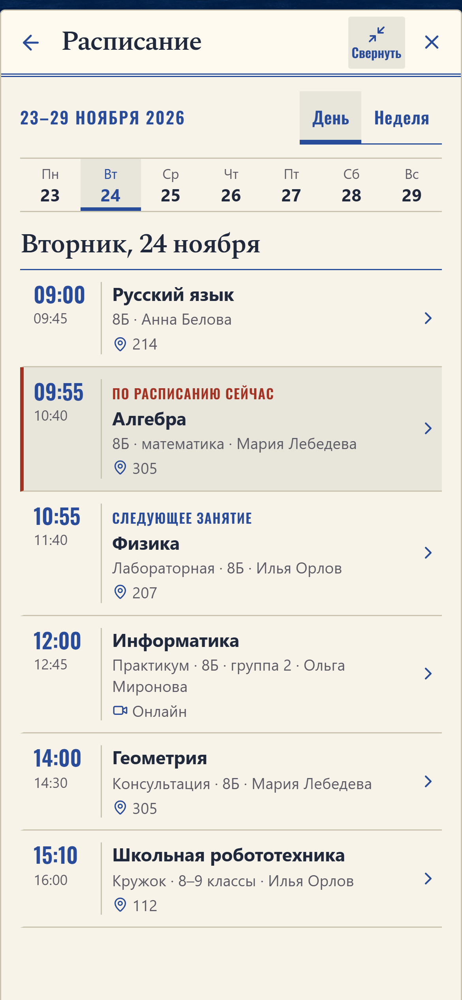

# Северная гавань · My Island

**[Открыть интерактивный кампус с телефона](https://raw.githack.com/Surpd/my-island/refs/heads/codex/campus-design-review/prototypes/campus/review/mobile/index.html)** · [Отчёт для ревью](./AUDIT.md) · [Автономная версия в ZIP](https://github.com/Surpd/my-island/raw/refs/heads/codex/campus-design-review/prototypes/campus/review/My-Island-Campus.zip)

Если CDN покажет **One more step**, нажмите **Open the page**. Коснитесь крыши корпуса с часами, его подписи или карточки текущего урока. В расписании выберите день, откройте урок и вернитесь стрелкой. Кнопка «Свернуть» оставляет вид на остров, «Развернуть» возвращает рабочую высоту. Крестик возвращает на остров с любого уровня.

В шестерёнке доступны освещение, движение и крупный текст. В блоке «Для демонстрации» выберите учителя, откройте «Группы» и состав группы 8Б. Демонстрационные роли и назначения используют вымышленные данные. Школьный день в примерах зафиксирован на 24 ноября 2026 года, 10:10. Автоматическое освещение использует часы устройства. Ручной выбор сохраняется.

<a href="./review/harbour-mobile.png"></a>
<a href="./review/harbour-schedule-expanded.png"></a>
<a href="./review/harbour-group-nested.png"></a>

[Ночной порт](./review/harbour-night.png) · [Крупный текст](./review/harbour-large-text.png) · [Посмотреть приближение и возврат при DPR 3](https://raw.githack.com/Surpd/my-island/refs/heads/codex/campus-design-review/prototypes/campus/review/harbour-tour-dpr3.mp4)

## Локальная проверка

Команды выполняются из корня проекта после `npm ci`. Запустите Vite в первом терминале, откройте [локальное демо](http://127.0.0.1:4176), а проверки — во втором. Для другого сервера задайте `CAMPUS_URL`. Playwright использует установленные Chromium и WebKit.

```powershell
node node_modules/vite/bin/vite.js --config prototypes/campus/vite.config.mjs
```

```powershell
node prototypes/campus/check.mjs
$env:CAMPUS_WEBKIT='1'
node prototypes/campus/check.mjs
```

Для ревью онлайн-сборка использует изображения и шрифты этой ветки. Автономный HTML содержит все ресурсы. Распакуйте ZIP и откройте HTML в браузере с JavaScript. Чтобы пересобрать оба варианта:

```powershell
node prototypes/campus/preview.mjs
node prototypes/campus/export.mjs "$env:TEMP/My-Island-Campus.html"
Compress-Archive -LiteralPath "$env:TEMP/My-Island-Campus.html" -DestinationPath prototypes/campus/review/My-Island-Campus.zip -Force
```

[Контракты будущей интеграции с расписанием, журналами и Classroom](./DATA.md)
