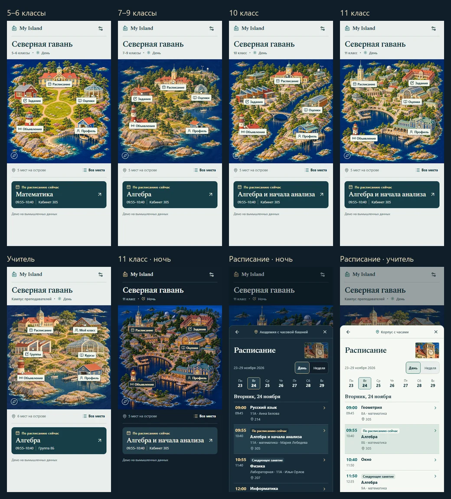

# Северная гавань · My Island

[Открыть интерактивный остров на телефоне](https://raw.githack.com/Surpd/my-island/refs/heads/codex/campus-design-review/prototypes/campus/review/mobile/index.html) · [Скачать автономное демо](https://github.com/Surpd/my-island/raw/refs/heads/codex/campus-design-review/prototypes/campus/review/My-Island-Campus.zip) · [Отчёт для ревью](./AUDIT.md)

Открывайте ссылку на телефон в Safari или Chrome. На первом экране видны остров и подписи зданий. Коснитесь корпуса с часами, откройте урок и вернитесь стрелкой. Крестик возвращает сразу на остров. Кнопка «Все места» даёт тот же маршрут списком.

Шестерёнка в правом верхнем углу открывает настройки. Выберите «Ночь», затем переключите возрастной кампус с 5–6 на 11 класс. Для преподавательского острова выберите роль «Учитель». Те же настройки доступны в профиле. Выбор сохраняется в этом браузере. «Автоматически» использует часы телефона, с 20:00 до 07:00 действует ночной свет. Школьный день в расписании зафиксирован на 24 ноября 2026 года, 10:10, для воспроизводимого ревью.



[Посмотреть запись перехода](./review/harbour-tour.gif) · [Открыть кадр в полном размере](./review/harbour-mobile.png)

## Запуск из исходников

Из корня репозитория с установленными зависимостями (`npm ci`) запустите Vite. По умолчанию демо доступно на [порту 4176](http://127.0.0.1:4176). Во втором окне можно запустить матрицу Playwright с установленным Chromium. Переменная `CAMPUS_URL` позволяет указать другой адрес или автономный HTML по `file:///`.

```powershell
node node_modules/vite/bin/vite.js --config prototypes/campus/vite.config.mjs
node prototypes/campus/check.mjs
```

Для обновления двух форматов ревью используются команды ниже. Онлайн-версия загружает изображения и шрифты по мере использования из этой же ветки. ZIP содержит один HTML со всеми ресурсами. Распакованный файл нужно открыть в браузере с JavaScript. Встроенные просмотрщики файлов на телефоне могут показывать только статический остров.

```powershell
node prototypes/campus/preview.mjs
node prototypes/campus/export.mjs "$env:TEMP/My-Island-Campus.html"
Compress-Archive -LiteralPath "$env:TEMP/My-Island-Campus.html" -DestinationPath prototypes/campus/review/My-Island-Campus.zip -Force
```

Публичная ссылка служит для ревью синтетических данных через CDN raw.githack. В рабочем приложении роли, класс и назначения должны приходить из подтверждённой школьной сессии. Подробности по контрактам расписания, журналов и Classroom собраны в [плане интеграции](./DATA.md).
