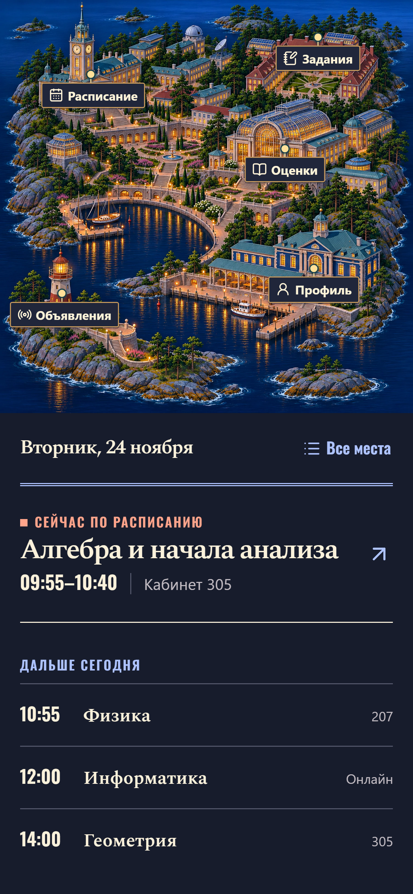
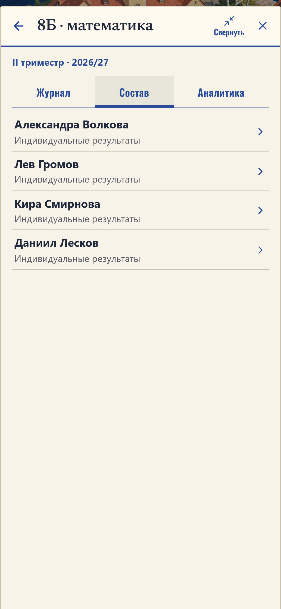
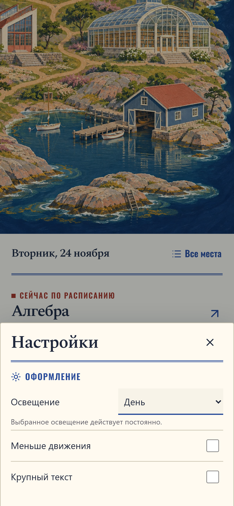

# Северная гавань · My Island

**[Открыть остров на телефоне](https://raw.githack.com/Surpd/my-island/refs/heads/codex/campus-design-review/prototypes/campus/review/mobile/index.html)** · **[Открыть инструменты предпросмотра](https://raw.githack.com/Surpd/my-island/refs/heads/codex/campus-design-review/prototypes/campus/review/mobile/preview.html)** · [Отчёт для ревью](./AUDIT.md)

Первая ссылка открывает остров ученицы 8Б. Коснитесь крыши, фасада или подписи корпуса с часами, чтобы увидеть расписание. Выберите урок и вернитесь стрелкой. Кнопки «Свернуть» и «Развернуть» меняют высоту раздела. Крестик возвращает на остров с любого уровня. Если CDN покажет **One more step**, нажмите **Open the page**.

В здании **Профиль → Настройки** доступны освещение, уменьшение движения и крупный текст. Автоматическая ночь наступает в 20:00 и заканчивается в 07:00 по часам устройства. Для демонстрационных уроков зафиксировано 10:10 вторника 24 ноября 2026 года.

Вторая ссылка открывает форму проверки. Выберите ступень или преподавателя, классное руководство и состояние данных. Нажмите **Открыть кампус**. Во время просмотра сценария внизу профиля есть ссылка обратно в инструменты.

<a href="./review/harbour-mobile.png"></a>
<a href="./review/harbour-night.png"></a>
<a href="./review/harbour-schedule-expanded.png"></a>
<a href="./review/harbour-group-nested.png"></a>
<a href="./review/harbour-settings.png"></a>

[Запись перехода от корпуса в расписание и обратно](https://raw.githack.com/Surpd/my-island/refs/heads/codex/campus-design-review/prototypes/campus/review/tour.html) · [Пример крупного текста](./review/harbour-large-text.png) · [Скачать автономную версию](https://github.com/Surpd/my-island/raw/refs/heads/codex/campus-design-review/prototypes/campus/review/My-Island-Campus.zip)

## Локальная проверка

После `npm ci` запустите Vite из корня проекта. Обычный вход доступен на [локальной странице](http://127.0.0.1:4176), выбор сценария — на [странице предпросмотра](http://127.0.0.1:4176/?preview=1). Проверки запускаются во втором терминале с установленными браузерами Playwright. Адрес сервера можно передать в `CAMPUS_URL`.

```powershell
node node_modules/vite/bin/vite.js --config prototypes/campus/vite.config.mjs
```

```powershell
node prototypes/campus/check.mjs
$env:CAMPUS_WEBKIT='1'
node prototypes/campus/check.mjs
```

Онлайн-сборка использует изображения и шрифты из каталога прототипа. Автономный HTML содержит все ресурсы. Распакуйте ZIP и откройте HTML в браузере с JavaScript. Параметр `?preview=1` открывает форму сценариев и в автономном файле.

```powershell
node prototypes/campus/preview.mjs
node prototypes/campus/export.mjs "$env:TEMP/My-Island-Campus.html"
Compress-Archive -LiteralPath "$env:TEMP/My-Island-Campus.html" -DestinationPath prototypes/campus/review/My-Island-Campus.zip -Force
```

[Контракты будущей интеграции с расписанием, журналами и Classroom](./DATA.md)
